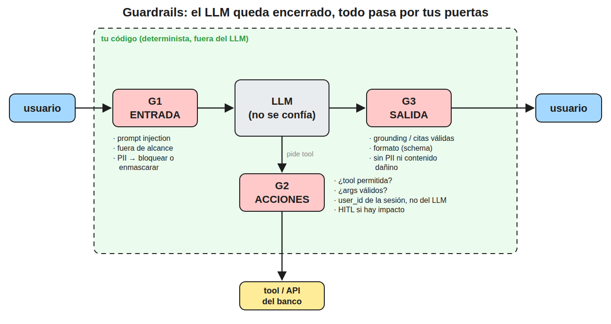

Un guardrail es un control determinista, fuera del LLM, que valida lo que entra al modelo, lo
que el modelo pide hacer y lo que responde contra las políticas de la empresa, de modo que la
seguridad no depende de que el modelo obedezca su prompt.

## 1. La idea

- El LLM no separa instrucciones de datos, así que cualquier texto puede cambiar su
  comportamiento (prompt injection), por lo que se trata como un componente no confiable
- El modelo queda encerrado y todo lo que cruza su frontera pasa por una puerta que controla
  tu código, implementada con reglas, regex, schemas, un clasificador o un servicio como
  Bedrock Guardrails
- Ante una violación el guardrail bloquea, enmascara, corrige o deriva a un humano, y registra
  el evento para auditoría

## 2. Las tres puertas

- **G1 Entrada**, antes de llamar al modelo
  - detecta prompt injection directa (usuario) e indirecta (documento del RAG, web, correo)
  - rechaza temas fuera de alcance
  - enmascara o elimina PII antes de que llegue al LLM y a los logs
- **G2 Acciones**, cuando el modelo pide ejecutar una tool
  - la tool está en la lista permitida para ese usuario y ese flujo
  - los argumentos cumplen el schema y los rangos de negocio
  - la identidad (`user_id`, cuenta) sale de la sesión autenticada, nunca del texto del LLM
  - las acciones con impacto sobre el cliente pasan por aprobación humana (HITL)
- **G3 Salida**, antes de responder al usuario
  - grounding: lo afirmado está en el contexto recuperado y los ids citados existen
  - formato: la respuesta valida contra el schema esperado
  - sin PII ni contenido dañino o fuera de política

## 3. Guardrail y mínimo privilegio

- El mínimo privilegio es una decisión de diseño (qué tools existen y con qué permisos IAM),
  mientras que el guardrail es un chequeo en tiempo de ejecución sobre cada llamada
- Se combinan porque la detección puede fallar, así que además de detectar se limita el daño
  posible, con mínimo privilegio, HITL en lo crítico y todo auditado

## 4. Respuesta corta para entrevista

> Un guardrail es un control fuera del modelo que valida la entrada, las acciones y la salida
> contra las políticas, y asumo que la detección puede fallar, así que lo combino con mínimo
> privilegio, revisión humana en lo crítico y auditoría.
