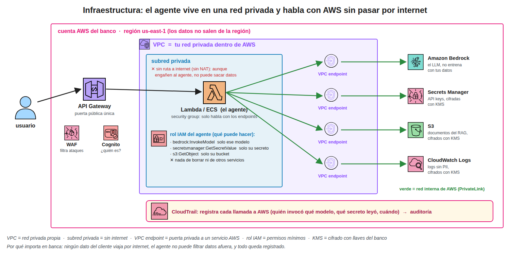

El agente corre en una subred privada sin salida a internet y habla con Bedrock, Secrets
Manager, S3 y CloudWatch por VPC endpoints, de modo que ningún dato del cliente viaja por
internet y, aunque engañen al agente con prompt injection, no tiene por dónde sacar datos.

## 1. Piezas

- **API Gateway**, la única puerta pública, con WAF para filtrar ataques web y Cognito para
  autenticar al usuario
- **VPC**, la red privada propia dentro de AWS, donde nadie de afuera puede entrar
- **Subred privada**, la parte de la VPC sin ruta a internet (sin NAT), donde vive el agente
- **Security group**, el firewall del agente, que solo permite hablar con los endpoints
- **VPC endpoint (PrivateLink)**, una puerta privada desde la VPC hacia un servicio de AWS,
  para llegar a Bedrock o S3 por la red interna de AWS en lugar de internet
- **Rol IAM**, los permisos del agente, con lo mínimo y sobre recursos específicos (solo ese
  modelo, solo ese secreto, solo ese bucket, nada de borrar)
- **KMS**, el cifrado en reposo de secretos, documentos y logs con llaves que controla el banco
- **CloudTrail**, el registro de cada llamada a la API de AWS, quién invocó qué modelo y qué
  secreto leyó, que alimenta la auditoría
- **Región**, los datos y el modelo se quedan en la región elegida por cumplimiento

## 2. Respuesta corta para entrevista

> El agente corre en una subred privada sin internet y llega a Bedrock y a los demás servicios
> por VPC endpoints, con un rol IAM de mínimo privilegio, cifrado KMS y CloudTrail, así ningún
> dato sale a internet y todo queda auditado.
