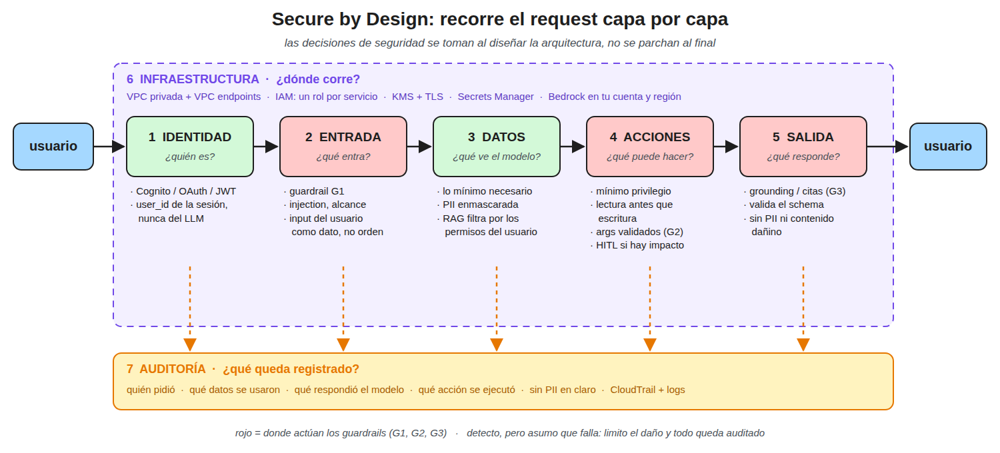

Secure by Design es tomar las decisiones de seguridad al diseñar la arquitectura y no
parcharlas al final, recorriendo el request capa por capa y definiendo en cada una qué se
controla.

## 1. Las capas

- **Identidad**, ¿quién es?, autenticación con Cognito, OAuth o JWT, y el `user_id` sale de la
  sesión, nunca del texto ni del LLM
- **Entrada**, ¿qué entra?, guardrail de entrada contra injection y temas fuera de alcance, con
  el input del usuario tratado como dato y no como instrucción
- **Datos**, ¿qué ve el modelo?, lo mínimo necesario, PII enmascarada y el RAG filtrado por los
  permisos del usuario
- **Acciones**, ¿qué puede hacer?, tools con mínimo privilegio, lectura antes que escritura,
  argumentos validados y HITL en lo que tiene impacto
- **Salida**, ¿qué responde?, grounding y citas válidas, schema validado, sin PII ni contenido
  dañino
- **Infraestructura**, ¿dónde corre?, ver [[infra-privada]], VPC privada con VPC endpoints, un rol IAM por servicio,
  KMS y TLS, secretos en Secrets Manager y el modelo en la cuenta y región del banco
- **Auditoría**, ¿qué queda registrado?, quién pidió, qué datos se usaron, qué respondió el
  modelo y qué acción se ejecutó, sin PII en claro

Las capas de entrada, acciones y salida son donde actúan los [[guardrails]].

## 2. Respuesta corta para entrevista

> Es tomar las decisiones de seguridad al diseñar y no al final, y en un agente significa
> definir en cada capa quién es el usuario, qué entra al modelo, qué datos ve, qué puede hacer,
> qué sale, dónde corre y qué queda auditado.
