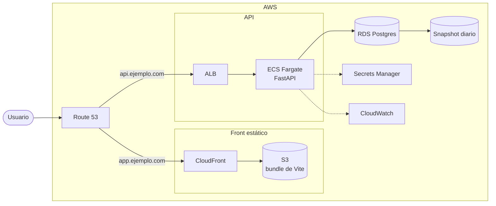

La presente nota toma la aplicación construida en los cuatro tutoriales
anteriores y la diseña de nuevo como lo pide una entrevista de system design,
del enunciado al análisis, del análisis a las requests y de las requests a la
arquitectura.

El énfasis está en el recorrido, cada decisión sale de algo que el enunciado
dijo o calló.

El contenido se distribuye entonces de la siguiente manera:

1. [Enunciado del problema](#1-enunciado-del-problema)
2. [Requisitos funcionales](#2-requisitos-funcionales)
3. [Requisitos no funcionales](#3-requisitos-no-funcionales)
4. [Estimación de carga](#4-estimación-de-carga)
5. [Requests principales y modelo de datos](#5-requests-principales-y-modelo-de-datos)
6. [Arquitectura en AWS](#6-arquitectura-en-aws)
7. [Defensa del diseño](#7-defensa-del-diseño)

## 1. Enunciado del problema

> Diseñe una aplicación de lista de tareas. Cada usuario entra desde el
> navegador, crea tareas con un nombre, las ve en una lista que puede filtrar
> por estado, les cambia el estado y las borra. Las tareas no se pueden perder y
> el sistema debe sostener 10 000 usuarios activos al día.

## 2. Requisitos funcionales

Las cinco acciones que el enunciado pide, cada una sobre las tareas de un
usuario:

1. Crear una tarea con un nombre.
2. Leer una tarea por su identificador.
3. Listar las tareas del usuario, con filtro por estado y paginación.
4. Cambiar el estado de una tarea.
5. Borrar una tarea.

Queda fuera del alcance la búsqueda por texto, las etiquetas, los adjuntos, las
notificaciones y compartir una tarea entre usuarios.

## 3. Requisitos no funcionales

Cada uno sale de una frase del enunciado:

- Durabilidad, una tarea creada no se pierde nunca
- Consistencia, lo que se acaba de escribir se lee al toque
- Latencia, `p95` bajo 200 ms en el listado
- Disponibilidad, 99.9% al mes, unos 43 minutos de caída
- Escala, crecer hasta diez veces sin reescribir la aplicación

El enunciado calla tres cosas que hay que preguntar, y mientras tanto se suponen:

- Cada tarea tiene un dueño, así que hay cuentas y sesión
- Un usuario no pasa de unos cientos de tareas
- Los 10 000 usuarios son activos al día, no en simultáneo, y el sistema arranca
  en una sola región

## 4. Estimación de carga

Las suposiciones se escriben primero, y los números salen de ahí:

| Suposición                     | Valor  |
| ------------------------------ | ------ |
| Usuarios activos al día        | 10 000 |
| Listados por usuario al día    | 20     |
| Escrituras por usuario al día  | 5      |
| Tamaño de una tarea en la base | 300 B  |

```text
lecturas   = 10 000 × 20 = 200 000 / día = 2.3 req/s, con pico ×10 = 23 req/s
escrituras = 10 000 × 5  =  50 000 / día = 0.6 req/s, con pico ×10 =  6 req/s
datos      = 50 000 × 365 × 300 B = 5.5 GB al año
```

La conclusión es incómoda y hay que decirla: 23 peticiones por segundo y 5 GB al
año entran en una sola máquina con Postgres, sin caché, sin réplicas y sin cola.
El diseño interesante acá no es escalar, es no perder datos y no caerse.

## 5. Requests principales y modelo de datos

Cada acción del enunciado es una request:

| Request              | Acción               | Éxito | Errores      |
| -------------------- | -------------------- | ----- | ------------ |
| `POST /tasks`        | Crear una tarea      | `201` | `401`, `422` |
| `GET /tasks/{id}`    | Leer una tarea       | `200` | `401`, `404` |
| `GET /tasks`         | Listar las tareas    | `200` | `401`, `422` |
| `PATCH /tasks/{id}`  | Cambiar el estado    | `200` | `401`, `404` |
| `DELETE /tasks/{id}` | Borrar una tarea     | `204` | `401`, `404` |

El cuerpo que viaja en la creación lleva solo lo que el cliente conoce:

```json
{ "name": "Comprar leche" }
```

Y la respuesta agrega lo que decide el servidor:

```json
{
  "id": "a211f5b3-a524-4b20-8d79-c305cab17ce7",
  "name": "Comprar leche",
  "status": "todo",
  "created_at": "2026-10-16T18:08:32Z",
  "updated_at": null,
  "due_date": null
}
```

El listado envuelve el resultado, porque el cliente necesita saber cuántas hay
más allá de la página que pidió:

```json
{ "items": [], "total": 128 }
```

## 6. Arquitectura en AWS




| Servicio        | Responsabilidad                                        |
| --------------- | ------------------------------------------------------ |
| Route 53        | Resolver los dos subdominios                           |
| CloudFront      | Servir el front cerca del usuario y terminar TLS        |
| S3              | Guardar el `index.html`, el JS y el CSS                 |
| ALB             | Repartir el tráfico entre las tareas de ECS y revisar `/health` |
| ECS Fargate     | Correr la API sin administrar servidores                |
| RDS Postgres    | Guardar las tareas, con copia automática                |
| Secrets Manager | Guardar la contraseña de la base fuera del código       |
| CloudWatch      | Logs y alarmas de errores `5xx` y latencia              |

Dos decisiones del dibujo que un entrevistador va a picar:

- El front es estático, así que no necesita servidor, sale de S3 por CloudFront
- La API corre en Fargate y no en Lambda porque la conexión a Postgres es
  persistente y el arranque en frío no juega a favor de una pantalla
  interactiva, con la contra de pagar la tarea aunque no haya tráfico

## 7. Defensa del diseño

Lo que un entrevistador va a picar, y con qué se responde.

1. ¿Por qué ECS Fargate y no Lambda con API Gateway?

   La API mantiene una conexión abierta a Postgres y la pantalla es
   interactiva, dos cosas que el arranque en frío y el modelo por invocación
   complican. La contra es pagar la tarea aunque no haya tráfico, que a este
   volumen son unos dólares

2. ¿Por qué RDS Postgres y no DynamoDB?

   El listado filtra por estado, ordena y cuenta el total, tres cosas que en
   una base relacional son una consulta con un índice. En DynamoDB habría que
   modelar un índice secundario por cada acceso y el conteo saldría aparte

3. ¿Por qué el front sale de S3 y no del mismo servidor de la API?

   Son archivos iguales para todos los usuarios, servirlos desde CloudFront los
   acerca al navegador y le quita a la API un tráfico que no necesita tocar la
   base

4. ¿Por qué un cursor y no `offset` y `limit`?

   El `OFFSET` recorre y descarta las filas que se salta, así que la página 500
   cuesta más que la 1, y con escrituras en medio una tarea puede aparecer dos
   veces o ninguna

5. ¿Por qué no hay caché?

   A 23 peticiones por segundo la base no es el cuello de botella, y una caché
   agrega el problema de invalidarla en cada escritura. Entra cuando una
   medición diga que hace falta, no antes

6. ¿Por qué un solo servicio y no microservicios?

   Cinco endpoints sobre una tabla comparten el mismo ciclo de vida y los
   mismos datos, partirlos agrega red, despliegues y fallas parciales sin
   resolver nada

7. ¿Qué se rompe primero cuando esto crece?

   | Pieza                 | Cuándo                                | Síntoma                |
   | --------------------- | ------------------------------------- | ---------------------- |
   | Listado sin índice    | Con cientos de miles de tareas        | El `p95` y la CPU suben |
   | Conexiones a Postgres | Con varias tareas de ECS a la vez     | `too many connections` |
   | Una sola tarea de ECS | En cada despliegue o reinicio         | Caída completa          |

   Se arreglan de a uno y en ese orden, ninguno con más máquinas

8. ¿Qué cambia si la carga se multiplica por cien?

   Más tareas de Fargate, porque la API no guarda estado; RDS Proxy para no
   abrir una conexión por tarea; una réplica de lectura para el listado, que
   tolera ir unos segundos atrás. Las escrituras siguen en la primaria

9. ¿Cuál es el riesgo real de este diseño?

   Perder datos, no la escala. Si el snapshot diario no se prueba restaurando,
   el día que haga falta no sirve, y eso pasa mucho antes que las 2 300
   peticiones por segundo
