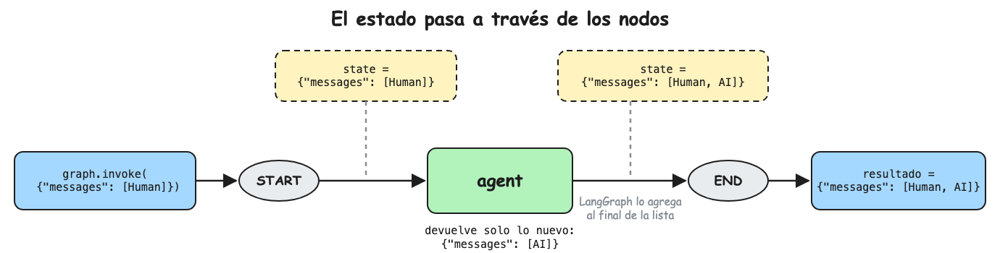

La presente nota es un tutorial para implementar un agente de soporte al cliente
para una tienda online con LangGraph. En esta primera parte el agente solo
conversa y recuerda la conversación; las herramientas se agregan en
[[Tutoriales/agente-soporte/2-herramientas|la nota siguiente]].

Cada paso es un archivo completo e independiente, que se ejecuta con
`uv run <archivo>`.

El contenido se distribuye entonces de la siguiente manera:

1. [Setup del proyecto](#1-setup-del-proyecto)
2. [Conexión con el modelo](#2-conexión-con-el-modelo)
3. [El estado en LangGraph](#3-el-estado-en-langgraph)
4. [Implementación del agente](#4-implementación-del-agente)
5. [Memoria por conversación](#5-memoria-por-conversación)
6. [Chat en la terminal](#6-chat-en-la-terminal)
7. [Preguntas de entrevista](#7-preguntas-de-entrevista)

## 1. Setup del proyecto

El proyecto se crea con `uv`:

```bash
uv init support-agent
cd support-agent
uv add langgraph langchain langchain-anthropic python-dotenv rich
```

- `langgraph` : implementa el agente y su memoria
- `langchain` : `init_chat_model`, que crea el cliente de cualquier proveedor
- `langchain-anthropic` : el proveedor de Claude
- `python-dotenv` : carga la API key desde `.env`
- `rich` : imprime en la terminal con colores y formato

Agregue al final de `pyproject.toml` la ubicación del entorno virtual, para que
el LSP de Python (pyright) encuentre las dependencias instaladas por `uv`:

```toml
# pyproject.toml
[tool.pyright]
venvPath = "."
venv = ".venv"
```

Cree el archivo `.env` con su API key de Anthropic, y agréguelo a `.gitignore`:

```bash
ANTHROPIC_API_KEY=sk-ant-...
```

## 2. Conexión con el modelo

Cree el archivo `modelo.py`:

```python
# modelo.py
import os

from dotenv import load_dotenv
from langchain.chat_models import init_chat_model

# Carga ANTHROPIC_API_KEY desde .env antes de crear el modelo
load_dotenv()

# El modelo se lee de la variable MODEL para cambiarlo sin tocar el código,
# por ejemplo MODEL=anthropic:claude-haiku-5-5 para practicar más barato
model = init_chat_model(os.getenv("MODEL", "anthropic:claude-opus-5-5"))

response = model.invoke("Hola, preséntate en una línea")
print(response.content)
# Tokens de entrada y salida de la llamada, la base para calcular el costo
print(response.usage_metadata)
```

Ejecute el archivo:

```bash
uv run modelo.py
```

```text
¡Hola! Soy Claude, un asistente de IA creado por Anthropic.
{'input_tokens': 14, 'output_tokens': 18, 'total_tokens': 32, ...}
```

## 3. El estado en LangGraph

El estado es lo que pasa a través de los nodos del grafo. Es un diccionario con
la llave `messages`, una lista con todos los mensajes de la conversación:

```python
state = {
    "messages": [
        HumanMessage(content="Hola, compré unos audífonos y no llegan"),  # el cliente
        AIMessage(content="Lamento la demora. ¿Me compartes el número de tu pedido?"),  # el modelo
    ]
}
```

Cada nodo recibe este diccionario y devuelve solo el mensaje nuevo,
`{"messages": [response]}`. LangGraph se encarga por detrás de agregarlo al
final de la lista.



## 4. Implementación del agente

El agente es un nodo de LangGraph: recibe la lista de mensajes, le antepone las
instrucciones de su rol (`SYSTEM_PROMPT`), llama al modelo y devuelve la
respuesta.

Cree el archivo `agente.py`:

```python
# agente.py
from dotenv import load_dotenv
from langchain.chat_models import init_chat_model
from langchain_core.messages import HumanMessage, SystemMessage
from langgraph.graph import END, START, MessagesState, StateGraph
from rich import print

load_dotenv()

model = init_chat_model("anthropic:claude-haiku-5-5")

SYSTEM_PROMPT = (
    "Eres el agente de soporte de una tienda online. "
    "Responde breve y amable, en el idioma del cliente."
)


def agent(state: MessagesState) -> dict:
    # state["messages"] = los mensajes que recibió el grafo en invoke
    history_chat = [SystemMessage(SYSTEM_PROMPT)] + state["messages"]
    # history_chat = state["messages"]  # sin system prompt, para comparar

    response = model.invoke(history_chat)

    # add_messages agrega response a state["messages"]
    return {"messages": [response]}


builder = StateGraph(MessagesState)
builder.add_node("agent", agent)
builder.add_edge(START, "agent")
builder.add_edge("agent", END)
graph = builder.compile()


session_state: MessagesState = {"messages": [HumanMessage(content="Hola, compré unos audífonos y no llegan")]}
state = graph.invoke(session_state)
# state["messages"] = [Human, AI]
print(session_state["messages"][-1].content)
print(state["messages"][-1].content)
```

```bash
uv run agente.py
```

```text
Hola, compré unos audífonos y no llegan
Lamento la demora. ¿Me compartes el número de tu pedido para revisarlo?
```

## 5. Memoria por conversación

Hasta aquí cada llamada empieza de cero. Para que el agente recuerde la
conversación se agrega un checkpointer, que guarda el estado al final de cada
`invoke` y lo recupera en el siguiente con el mismo `thread_id`.

Cree el archivo `memoria.py`:

```python
# memoria.py
from dotenv import load_dotenv
from langchain.chat_models import init_chat_model
from langchain_core.messages import HumanMessage, SystemMessage
from langchain_core.runnables import RunnableConfig
from langgraph.checkpoint.memory import InMemorySaver
from langgraph.graph import END, START, MessagesState, StateGraph
from rich import print

load_dotenv()

model = init_chat_model("anthropic:claude-haiku-5-5")

SYSTEM_PROMPT = (
    "Eres el agente de soporte de una tienda online. "
    "Responde breve y amable, en el idioma del cliente."
)


def agent(state: MessagesState) -> dict:
    # state["messages"] = todo el historial del thread, recuperado por el checkpointer
    history_chat = [SystemMessage(SYSTEM_PROMPT)] + state["messages"]
    # history_chat = state["messages"]  # sin system prompt, para comparar

    response = model.invoke(history_chat)

    # add_messages agrega response al historial guardado
    return {"messages": [response]}


builder = StateGraph(MessagesState)
builder.add_node("agent", agent)
builder.add_edge(START, "agent")
builder.add_edge("agent", END)
# El checkpointer guarda el estado al final de cada invoke, indexado por thread_id
graph = builder.compile(checkpointer=InMemorySaver())


# Todas las llamadas con thread_id "abc" comparten el mismo historial
session_config: RunnableConfig = {"configurable": {"thread_id": "abc"}}


# Se envía solo el mensaje nuevo
session_state: MessagesState = {"messages": [HumanMessage(content="Hola como estas")]}
state = graph.invoke(session_state, session_config)
# state["messages"] = [Human, AI]
print(session_state["messages"][-1].content)
print(state["messages"][-1].content)


session_state: MessagesState = {"messages": [HumanMessage(content="Yo estoy bien")]}
state = graph.invoke(session_state, session_config)
# state["messages"] = [Human, AI, Human, AI]  ← el checkpointer recuperó el primer turno
print(session_state["messages"][-1].content)
print(state["messages"][-1].content)


session_state: MessagesState = {"messages": [HumanMessage(content="hoy es bueno")]}
state = graph.invoke(session_state, session_config)
# state["messages"] = [Human, AI, Human, AI, Human, AI]
print(session_state["messages"][-1].content)
print(state["messages"][-1].content)
```

Ejecute el archivo:

```bash
uv run memoria.py
```

```text
Hola como estas
¡Hola! Estoy bien, gracias. ¿En qué puedo ayudarte hoy?
Yo estoy bien
¡Qué bueno! Cuéntame, ¿necesitas ayuda con algún pedido?
hoy es bueno
¡Me alegra! Si necesitas algo de la tienda, aquí estoy.
```

En cada `invoke` se envía un solo mensaje, pero el modelo responde con el
contexto de los turnos anteriores, porque el checkpointer los recuperó. Para
comprobarlo, cambie el `thread_id` de la segunda llamada: el agente responde
sin saber que antes lo saludaron.

## 6. Chat en la terminal

El mismo agente con memoria, pero el mensaje lo escribe usted en un bucle.

Cree el archivo `chat.py`:

```python
# chat.py
from dotenv import load_dotenv
from langchain.chat_models import init_chat_model
from langchain_core.messages import HumanMessage, SystemMessage
from langchain_core.runnables import RunnableConfig
from langgraph.checkpoint.memory import InMemorySaver
from langgraph.graph import END, START, MessagesState, StateGraph
from rich import print

load_dotenv()

model = init_chat_model("anthropic:claude-haiku-5-5")

SYSTEM_PROMPT = (
    "Eres el agente de soporte de una tienda online. "
    "Responde breve y amable, en el idioma del cliente."
)


def agent(state: MessagesState) -> dict:
    # state["messages"] = todo el historial del thread, recuperado por el checkpointer
    history_chat = [SystemMessage(SYSTEM_PROMPT)] + state["messages"]
    # history_chat = state["messages"]  # sin system prompt, para comparar

    response = model.invoke(history_chat)

    # add_messages agrega response al historial guardado
    return {"messages": [response]}


builder = StateGraph(MessagesState)
builder.add_node("agent", agent)
builder.add_edge(START, "agent")
builder.add_edge("agent", END)
# El checkpointer guarda el estado al final de cada invoke, indexado por thread_id
graph = builder.compile(checkpointer=InMemorySaver())


# Todas las llamadas con thread_id "abc" comparten el mismo historial
session_config: RunnableConfig = {"configurable": {"thread_id": "abc"}}


while (text := input("> ")) != "salir":
    # Se envía solo el mensaje nuevo; el checkpointer agrega el historial
    session_state: MessagesState = {"messages": [HumanMessage(content=text)]}
    state = graph.invoke(session_state, session_config)
    print(state["messages"][-1].content)
```

```bash
uv run chat.py
```

```text
> Hola, ¿hacen envíos a Trujillo?
Sí, hacemos envíos a todo el Perú, incluido Trujillo. ¿Te ayudo con algo más?
> ¿Y cuánto demora?
A Trujillo el envío demora entre 2 y 4 días hábiles.
> salir
```

## 7. Preguntas de entrevista

- **¿Dónde vive la memoria de una conversación?**\
  En el checkpointer, indexada por `thread_id`.
- **¿Qué pasa con `InMemorySaver` al reiniciar o con varios workers?**\
  Se pierde, y cada worker tendría la suya; en producción se usa Postgres o Redis.
- **¿Por qué el system prompt no se guarda en el historial?**\
  Se puede cambiar sin migrar conversaciones guardadas.
- **¿Qué problema aparece cuando la conversación crece mucho?**\
  Más costo y latencia por turno, y riesgo de pasar la ventana de contexto; se recorta o resume el historial.
- **¿Cómo cambiarías de proveedor de modelo?**\
  `init_chat_model` recibe `proveedor:modelo`; basta cambiar ese string, por ejemplo de `anthropic:...` a `openai:...`.
- **¿Para qué sirve el streaming en soporte?**\
  El cliente ve texto en el primer segundo aunque la respuesta completa tarde más.
