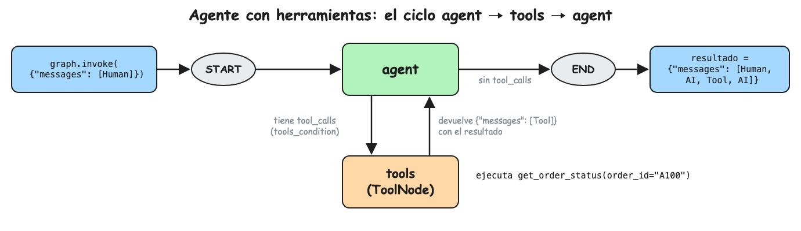

La presente nota continúa
[[Tutoriales/agente-soporte/1-agente-minimo|el agente mínimo]] dándole
herramientas para consultar pedidos y la política de devoluciones, en vez de
responder de memoria.

El contenido se distribuye entonces de la siguiente manera:

1. [El ciclo del agente con herramientas](#1-el-ciclo-del-agente-con-herramientas)
2. [Implementación del agente](#2-implementación-del-agente)
3. [Validación](#3-validación)
4. [Preguntas de entrevista](#4-preguntas-de-entrevista)

## 1. El ciclo del agente con herramientas

El modelo no ejecuta nada. Cuando necesita un dato responde con `tool_calls`,
es decir, qué herramienta usar y con qué argumentos. El nodo `tools` la ejecuta
y el resultado vuelve al modelo, que repite hasta poder responder.

Todo queda en el mismo estado de la nota anterior, la lista `messages`:

```python
state = {
    "messages": [
        HumanMessage("¿Dónde está mi pedido A100?"),  # el cliente
        AIMessage(tool_calls=[get_order_status(order_id="A100")]),  # el modelo pide un dato
        ToolMessage('{"status": "shipped", ...}'),  # el resultado de la herramienta
        AIMessage("Tu pedido A100 ya fue enviado."),  # el modelo responde
    ]
}
```



## 2. Implementación del agente

Cree el archivo `herramientas.py`:

```python
# herramientas.py
from dotenv import load_dotenv
from langchain.chat_models import init_chat_model
from langchain_core.messages import HumanMessage, SystemMessage
from langchain_core.tools import tool
from langgraph.graph import START, MessagesState, StateGraph
from langgraph.prebuilt import ToolNode, tools_condition

load_dotenv()

model = init_chat_model("anthropic:claude-haiku-5-5")

SYSTEM_PROMPT = (
    "Eres el agente de soporte de una tienda online. "
    "Responde breve y amable, en el idioma del cliente. "
    "Usa las herramientas para consultar datos, nunca los inventes."
)

# Simula la base de datos de pedidos
ORDERS = {
    "A100": {"status": "shipped", "item": "Audífonos", "days_since_delivery": None},
    "A101": {"status": "delivered", "item": "Teclado", "days_since_delivery": 5},
    "A102": {"status": "delivered", "item": "Monitor", "days_since_delivery": 45},
}


# El modelo elige la herramienta por su nombre, docstring y argumentos
@tool
def get_order_status(order_id: str) -> dict:
    """Devuelve el estado de un pedido a partir de su id, por ejemplo A100."""
    order = ORDERS.get(order_id)
    if order is None:
        return {"error": f"order {order_id} not found"}
    return {"order_id": order_id, **order}


@tool
def get_return_policy() -> str:
    """Devuelve la política de devoluciones de la tienda."""
    return "Se aceptan devoluciones hasta 30 días después de la entrega."


tools = [get_order_status, get_return_policy]
model_with_tools = model.bind_tools(tools)


def agent(state: MessagesState) -> dict:
    history_chat = [SystemMessage(SYSTEM_PROMPT)] + state["messages"]

    response = model_with_tools.invoke(history_chat)
    # response.tool_calls = [{"name": "get_order_status", "args": {"order_id": "A100"}, ...}]
    # o [] si el modelo ya puede responder

    return {"messages": [response]}


builder = StateGraph(MessagesState)
builder.add_node("agent", agent)
builder.add_node("tools", ToolNode(tools))
builder.add_edge(START, "agent")
builder.add_conditional_edges("agent", tools_condition)
builder.add_edge("tools", "agent")
graph = builder.compile()


session_state: MessagesState = {"messages": [HumanMessage(content="¿Puedo devolver el pedido A102?")]}
state = graph.invoke(session_state)
# state["messages"] = [Human, AI con tool_calls, Tool, Tool, AI]
for message in state["messages"]:
    message.pretty_print()
```

## 3. Validación

```bash
uv run herramientas.py
```

```text
================================ Human Message =================================

¿Puedo devolver el pedido A102?
================================== Ai Message ==================================
Tool Calls:
  get_order_status (toolu_01)
 Call ID: toolu_01
  Args:
    order_id: A102
  get_return_policy (toolu_02)
 Call ID: toolu_02
  Args:
================================= Tool Message =================================
Name: get_order_status

{"order_id": "A102", "status": "delivered", "item": "Monitor", "days_since_delivery": 45}
================================= Tool Message =================================
Name: get_return_policy

Se aceptan devoluciones hasta 30 días después de la entrega.
================================== Ai Message ==================================

Lo siento, el monitor se entregó hace 45 días y el plazo de devolución es de 30 días.
```

El modelo pidió las dos herramientas en un mismo mensaje (llamada paralela).

Cambie la pregunta del `HumanMessage` para probar otros casos:

- "¿Dónde está mi pedido A100?" usa solo `get_order_status`.
- "¿Dónde está mi pedido Z999?" recibe el error y pide verificar el número.
- "Hola" responde sin usar herramientas.

## 4. Preguntas de entrevista

- **¿El modelo ejecuta las herramientas?**\
  No; devuelve `tool_calls` con nombre y argumentos, y el código las ejecuta.
- **¿Cómo decide el modelo qué herramienta usar?**\
  Por el nombre, el docstring y el esquema de argumentos, que se envían como parte del prompt.
- **¿Para qué sirve el `tool_call_id`?**\
  Une cada resultado con la llamada que lo pidió; sin él el proveedor rechaza la conversación.
- **¿Cuándo termina el ciclo del agente?**\
  Cuando el modelo responde sin `tool_calls`; conviene además un límite de vueltas (`recursion_limit`).
- **¿Qué es una llamada paralela de herramientas?**\
  Varias `tool_calls` en un mismo mensaje; ahorra vueltas al modelo y baja la latencia.
- **¿Qué pasa si una herramienta lanza una excepción?**\
  Con `handle_tool_errors=True` el error vuelve al modelo como mensaje; sin eso, el agente se cae.
- **¿Cómo evitas que el agente invente datos?**\
  Herramientas para cada dato, errores explícitos, instrucción en el prompt y evaluaciones que lo midan.
- **¿Qué pasa si una herramienta devuelve mucho texto?**\
  Sube el costo y diluye la atención; se filtran campos o se pagina antes de devolverlo.
- **¿Cuándo usar un agente y cuándo un flujo fijo?**\
  Si los pasos son siempre los mismos, un flujo fijo es más barato y predecible; el agente sirve cuando el camino depende de la pregunta.
