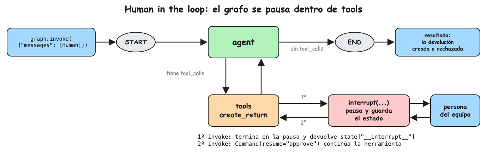

La presente nota continúa
[[Tutoriales/agente-soporte/2-herramientas|el agente con herramientas]]
agregando una herramienta para crear devoluciones, que solo se ejecuta si una
persona del equipo la aprueba.

El contenido se distribuye entonces de la siguiente manera:

1. [Pausa y reanudación del agente](#1-pausa-y-reanudación-del-agente)
2. [Implementación del agente](#2-implementación-del-agente)
3. [Validación](#3-validación)
4. [Re-ejecución del código antes de interrupt](#4-re-ejecución-del-código-antes-de-interrupt)
5. [Preguntas de entrevista](#5-preguntas-de-entrevista)

## 1. Pausa y reanudación del agente

Una herramienta pausa el grafo llamando a `interrupt(valor)`. LangGraph guarda
el estado en el checkpointer y `invoke` termina devolviendo ese `valor` en la
llave `__interrupt__`. Después, una persona decide y el grafo se reanuda con
`Command(resume=decisión)` y el mismo `thread_id`; en ese momento `interrupt`
devuelve la `decisión` y la herramienta continúa.

```python
state = graph.invoke(session_state, session_config)    # se pausa en interrupt
state["__interrupt__"]                                 # lo que hay que aprobar
state = graph.invoke(Command(resume="approve"), session_config)  # continúa
```



## 2. Implementación del agente

Cree el archivo `aprobacion.py`:

```python
# aprobacion.py
from dotenv import load_dotenv
from langchain.chat_models import init_chat_model
from langchain_core.messages import HumanMessage, SystemMessage
from langchain_core.runnables import RunnableConfig
from langchain_core.tools import tool
from langgraph.checkpoint.memory import InMemorySaver
from langgraph.graph import START, MessagesState, StateGraph
from langgraph.prebuilt import ToolNode, tools_condition
from langgraph.types import Command, interrupt
from rich import print

load_dotenv()

model = init_chat_model("anthropic:claude-haiku-5-5")

SYSTEM_PROMPT = (
    "Eres el agente de soporte de una tienda online. "
    "Responde breve y amable, en el idioma del cliente. "
    "Usa las herramientas para consultar datos, nunca los inventes."
)

# Simula la base de datos de pedidos y de devoluciones
ORDERS = {
    "A100": {"status": "shipped", "item": "Audífonos", "days_since_delivery": None},
    "A101": {"status": "delivered", "item": "Teclado", "days_since_delivery": 5},
    "A102": {"status": "delivered", "item": "Monitor", "days_since_delivery": 45},
}
RETURNS: list[dict] = []


@tool
def create_return(order_id: str, reason: str) -> dict:
    """Crea una devolución para un pedido entregado hace 30 días o menos.
    Requiere la aprobación de una persona del equipo."""
    order = ORDERS.get(order_id)
    if order is None:
        return {"error": f"order {order_id} not found"}
    if order["status"] != "delivered" or order["days_since_delivery"] > 30:
        return {"error": "order is not eligible for a return"}

    # El grafo se pausa aquí y guarda el estado en el checkpointer.
    # Al reanudar con Command(resume="approve"), decision = "approve"
    decision = interrupt({"order_id": order_id, "reason": reason})
    if decision != "approve":
        return {"status": "rejected by a human agent"}

    RETURNS.append({"order_id": order_id, "reason": reason})
    return {"status": "return created", "order_id": order_id}


tools = [create_return]
model_with_tools = model.bind_tools(tools)


def agent(state: MessagesState) -> dict:
    history_chat = [SystemMessage(SYSTEM_PROMPT)] + state["messages"]

    response = model_with_tools.invoke(history_chat)

    return {"messages": [response]}


builder = StateGraph(MessagesState)
builder.add_node("agent", agent)
builder.add_node("tools", ToolNode(tools))
builder.add_edge(START, "agent")
builder.add_conditional_edges("agent", tools_condition)
builder.add_edge("tools", "agent")
# interrupt necesita un checkpointer para guardar el punto de pausa
graph = builder.compile(checkpointer=InMemorySaver())


session_config: RunnableConfig = {"configurable": {"thread_id": "abc"}}


session_state: MessagesState = {"messages": [HumanMessage(content="Quiero devolver el pedido A101, no funciona")]}
state = graph.invoke(session_state, session_config)
# state["__interrupt__"] = [Interrupt(value={"order_id": "A101", "reason": "no funciona"})]
print(state["__interrupt__"][0].value)


# Una persona del equipo aprueba; el grafo continúa desde la pausa con el mismo thread_id
state = graph.invoke(Command(resume="approve"), session_config)
print(state["messages"][-1].content)
print(RETURNS)
```

## 3. Validación

```bash
uv run aprobacion.py
```

```text
{'order_id': 'A101', 'reason': 'no funciona'}
Listo, creé la devolución del pedido A101. Te llegarán las instrucciones por correo.
[{'order_id': 'A101', 'reason': 'no funciona'}]
```

Pruebe también estos casos:

- Cambie `Command(resume="approve")` por `Command(resume="reject")`. El agente
  avisa que la devolución no fue aprobada y `RETURNS` queda vacío.
- Cambie el pedido a A102, entregado hace 45 días. La herramienta responde con
  un error antes del `interrupt`, así que no hay pausa y el agente contesta
  directamente que no procede. Para verlo, imprima
  `state["messages"][-1].content` en lugar de `state["__interrupt__"]`.

## 4. Re-ejecución del código antes de interrupt

Al reanudar, LangGraph vuelve a ejecutar la herramienta **desde el principio**.
La segunda vez `interrupt` devuelve la decisión en vez de pausar, pero todo el
código anterior al `interrupt` se ejecuta dos veces.

Por ejemplo, si en `create_return` se enviara un correo antes del `interrupt`,
el cliente recibiría dos correos. La regla es:

- **Antes** del `interrupt`: solo lecturas y validaciones.
- **Después** del `interrupt`: lo que cambia datos o tiene efectos (crear la
  devolución, enviar correos, cobrar).

Si un efecto tiene que ir antes, debe ser idempotente, por ejemplo con una llave
única por pedido que impida registrarlo dos veces.

## 5. Preguntas de entrevista

- **¿Qué acciones de un agente deberían pedir aprobación humana?**\
  Las irreversibles o que mueven dinero o datos: devoluciones, pagos, borrados,
  mensajes a terceros.
- **¿Por qué `interrupt` necesita un checkpointer?**\
  El agente se detiene y su estado tiene que quedar guardado para reanudarlo más
  tarde.
- **¿La pausa bloquea un proceso mientras el humano decide?**\
  No; el estado queda en el checkpointer y cualquier proceso puede reanudarlo
  con el mismo `thread_id`.
- **¿Qué pasa con el código antes de `interrupt` al reanudar?**\
  Se vuelve a ejecutar; por eso no debe tener efectos secundarios.
- **¿Por qué validar las reglas de negocio en la herramienta y no en el
  prompt?**\
  El modelo puede equivocarse o ser manipulado; las reglas que protegen dinero
  se hacen cumplir en el código.
- **¿Cómo funcionaría la aprobación en producción?**\
  El `interrupt` crea un ticket o una notificación para el equipo; la decisión
  llega por una API que reanuda el thread con `Command(resume=...)`.
- **¿Qué métricas mirarías de este flujo?**\
  Tasa de aprobación, tiempo hasta la decisión y devoluciones creadas sin ser
  elegibles (debe ser 0).
