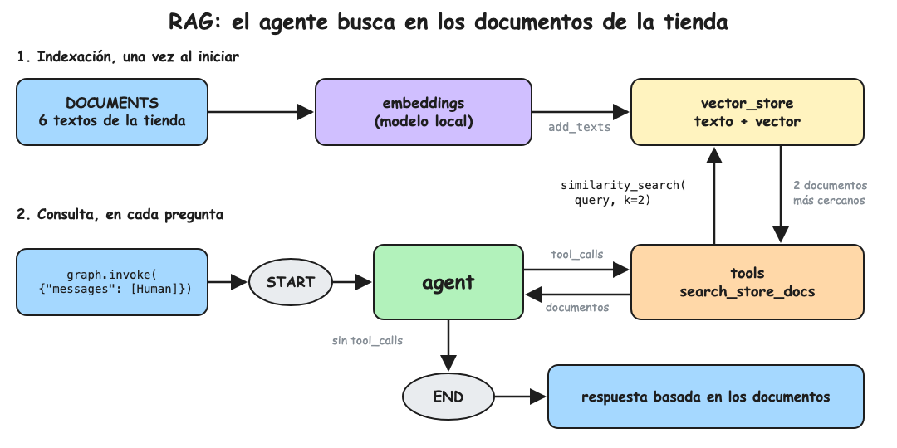

La presente nota continúa
[[Tutoriales/agente-soporte/2-herramientas|el agente con herramientas]]
dándole una herramienta que busca en los documentos de la tienda (políticas y
preguntas frecuentes), para que responda con esa información en vez de
inventarla.

El contenido se distribuye entonces de la siguiente manera:

1. [Funcionamiento de RAG](#1-funcionamiento-de-rag)
2. [Setup del modelo de embeddings](#2-setup-del-modelo-de-embeddings)
3. [Implementación del agente](#3-implementación-del-agente)
4. [Validación](#4-validación)
5. [Preguntas de entrevista](#5-preguntas-de-entrevista)

## 1. Funcionamiento de RAG

RAG (Retrieval-Augmented Generation) busca los documentos relacionados con la
pregunta y se los entrega al modelo para que responda con ellos. Tiene dos
partes:

- **Indexación**: cada documento se convierte en un vector (embedding) y se
  guarda junto con su texto en un vector store. Se hace una vez.
- **Consulta**: la pregunta también se convierte en vector y el vector store
  devuelve los documentos con los vectores más cercanos, es decir, los de
  significado más parecido aunque no compartan palabras.

En esta nota la búsqueda es una herramienta más del agente, igual que en la
nota 2: el modelo decide cuándo buscar y con qué texto.



## 2. Setup del modelo de embeddings

Anthropic no ofrece modelos de embeddings, así que se usa un modelo open source
que corre en su máquina. Claude sigue siendo el modelo que responde.

```bash
uv add langchain-huggingface sentence-transformers
```

- `langchain-huggingface` : `HuggingFaceEmbeddings`, que carga el modelo de
  embeddings
- `sentence-transformers` : la librería que ejecuta el modelo localmente

La primera ejecución descarga el modelo
`paraphrase-multilingual-MiniLM-L12-v2`, multilingüe para que funcione con
textos en español, y tarda cerca de un minuto. Las siguientes lo leen del disco.

## 3. Implementación del agente

Cree el archivo `rag.py`:

```python
# rag.py
from dotenv import load_dotenv
from langchain.chat_models import init_chat_model
from langchain_core.messages import HumanMessage, SystemMessage
from langchain_core.tools import tool
from langchain_core.vectorstores import InMemoryVectorStore
from langchain_huggingface import HuggingFaceEmbeddings
from langgraph.graph import START, MessagesState, StateGraph
from langgraph.prebuilt import ToolNode, tools_condition

load_dotenv()

model = init_chat_model("anthropic:claude-haiku-5-5")

# Modelo open source que corre local y convierte un texto en un vector de 384 números
embeddings = HuggingFaceEmbeddings(model_name="sentence-transformers/paraphrase-multilingual-MiniLM-L12-v2")

# Documentos de la tienda
DOCUMENTS = [
    "Devoluciones: se aceptan hasta 30 días después de la entrega, con el producto en su caja original.",
    "Reembolsos: el dinero se devuelve al mismo medio de pago en un plazo de 5 a 10 días hábiles.",
    "Envíos: a Lima demoran de 1 a 2 días hábiles y a provincias de 3 a 5 días hábiles.",
    "Envío gratis en compras mayores a 150 soles.",
    "Garantía: los productos electrónicos tienen 12 meses de garantía por fallas de fábrica; no cubre golpes ni humedad.",
    "Medios de pago: tarjeta de crédito o débito, Yape y transferencia bancaria.",
]

# Indexación: cada documento se guarda junto con su vector
vector_store = InMemoryVectorStore(embeddings)
vector_store.add_texts(DOCUMENTS)

SYSTEM_PROMPT = (
    "Eres el agente de soporte de una tienda online. "
    "Responde breve y amable, en el idioma del cliente. "
    "Responde solo con la información de los documentos de la tienda; si no está, dilo."
)


@tool
def search_store_docs(query: str) -> str:
    """Busca en las políticas y preguntas frecuentes de la tienda: devoluciones,
    reembolsos, envíos, garantía y medios de pago."""
    # query se convierte en vector y se devuelven los 2 documentos más cercanos
    docs = vector_store.similarity_search(query, k=2)
    return "\n\n".join(doc.page_content for doc in docs)


tools = [search_store_docs]
model_with_tools = model.bind_tools(tools)


def agent(state: MessagesState) -> dict:
    history_chat = [SystemMessage(SYSTEM_PROMPT)] + state["messages"]

    response = model_with_tools.invoke(history_chat)

    return {"messages": [response]}


builder = StateGraph(MessagesState)
builder.add_node("agent", agent)
builder.add_node("tools", ToolNode(tools))
builder.add_edge(START, "agent")
builder.add_conditional_edges("agent", tools_condition)
builder.add_edge("tools", "agent")
graph = builder.compile()


session_state: MessagesState = {"messages": [HumanMessage(content="Mi teclado dejó de funcionar a los 6 meses, ¿qué puedo hacer?")]}
state = graph.invoke(session_state)
# state["messages"] = [Human, AI con tool_calls, Tool con los documentos, AI]
for message in state["messages"]:
    message.pretty_print()
```

## 4. Validación

```bash
uv run rag.py
```

```text
================================ Human Message =================================

Mi teclado dejó de funcionar a los 6 meses, ¿qué puedo hacer?
================================== Ai Message ==================================
Tool Calls:
  search_store_docs (toolu_01)
 Call ID: toolu_01
  Args:
    query: garantía teclado dejó de funcionar
================================= Tool Message =================================
Name: search_store_docs

Garantía: los productos electrónicos tienen 12 meses de garantía por fallas de fábrica; no cubre golpes ni humedad.

Medios de pago: tarjeta de crédito o débito, Yape y transferencia bancaria.
================================== Ai Message ==================================

Tu teclado está dentro de los 12 meses de garantía por fallas de fábrica. ¿Me compartes el número de pedido para gestionarla?
```

La búsqueda siempre devuelve 2 documentos, aunque el segundo no tenga relación
con la pregunta, como el de medios de pago. El modelo usa solo el que sirve.

Cambie la pregunta del `HumanMessage` para probar otros casos:

- "¿Cuánto tarda un envío a Trujillo?" encuentra el documento de envíos aunque
  no diga "Trujillo".
- "¿Cuándo me devuelven el dinero?" encuentra el de reembolsos.
- "¿Venden tarjetas de regalo?" no está en los documentos y el agente debe
  decir que no tiene esa información.

## 5. Preguntas de entrevista

- **¿Qué es un embedding?**\
  Un vector de números que representa el significado de un texto; textos parecidos quedan cerca aunque usen palabras distintas.
- **¿Por qué la búsqueda es una herramienta y no se hace siempre antes de llamar al modelo?**\
  El modelo decide si hace falta buscar y reescribe la pregunta como consulta; un saludo no gasta una búsqueda.
- **¿Qué es el chunking y por qué importa?**\
  Dividir documentos largos en fragmentos antes de indexarlos; fragmentos muy grandes diluyen el significado y muy pequeños pierden contexto.
- **¿Cómo eliges `k`?**\
  Pocos documentos pueden dejar fuera la respuesta y muchos suben el costo y meten ruido; se ajusta midiendo con evaluaciones.
- **¿Qué es búsqueda híbrida?**\
  Combinar la búsqueda por vectores con búsqueda por palabras (BM25) y fusionar los rankings, por ejemplo con RRF; ayuda con códigos, nombres y términos exactos.
- **¿Para qué sirve un reranker?**\
  Reordena los candidatos de la búsqueda con un modelo más preciso y más lento, para quedarse con los mejores.
- **¿Qué vector store usarías en producción?**\
  Uno persistente como pgvector, Qdrant u OpenSearch; `InMemoryVectorStore` se pierde al reiniciar.
- **¿Cómo sabes si el RAG funciona bien?**\
  Con evaluaciones: context recall (se recuperaron los documentos necesarios) y faithfulness (la respuesta se basa en ellos y no inventa).
