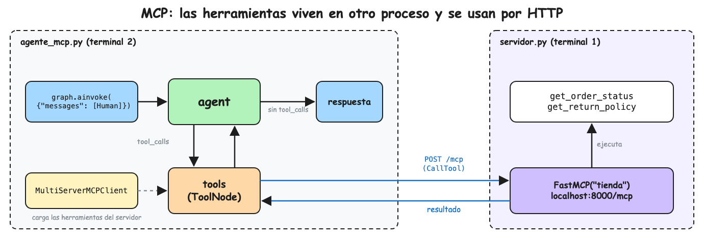

La presente nota toma las herramientas de
[[Tutoriales/agente-soporte/2-herramientas|el agente con herramientas]] y las
mueve a un servidor MCP que corre aparte. El agente las carga y las ejecuta por
HTTP, en vez de tenerlas definidas en su propio archivo.

El contenido se distribuye entonces de la siguiente manera:

1. [Funcionamiento de MCP](#1-funcionamiento-de-mcp)
2. [Setup del proyecto](#2-setup-del-proyecto)
3. [Implementación del servidor MCP](#3-implementación-del-servidor-mcp)
4. [Implementación del agente](#4-implementación-del-agente)
5. [Validación](#5-validación)
6. [Preguntas de entrevista](#6-preguntas-de-entrevista)

## 1. Funcionamiento de MCP

MCP (Model Context Protocol) es un protocolo estándar para exponer herramientas
a cualquier agente. Un servidor MCP publica sus herramientas con nombre,
descripción y argumentos; un cliente MCP pide la lista (`ListTools`) y las
ejecuta (`CallTool`). Así las mismas herramientas sirven para este agente,
Claude Desktop, Cursor o Claude Code sin reescribirlas.

En esta nota el servidor usa el transporte HTTP (streamable HTTP): corre como un
servicio en `http://localhost:8000/mcp` y el agente se conecta por red, igual
que con un MCP remoto. En producción la URL sería `https://...` con el
certificado en el balanceador o el API Gateway; el código no cambia.

Para LangGraph no hay nada nuevo: las herramientas del servidor se convierten en
herramientas de LangChain y se usan con el mismo `ToolNode` de la nota 2.



## 2. Setup del proyecto

```bash
uv add mcp langchain-mcp-adapters
```

- `mcp` : el SDK oficial de MCP, con `FastMCP` para crear el servidor
- `langchain-mcp-adapters` : `MultiServerMCPClient`, que convierte las
  herramientas de un servidor MCP en herramientas de LangChain

## 3. Implementación del servidor MCP

Cree el archivo `servidor.py`:

```python
# servidor.py
from mcp.server.fastmcp import FastMCP

# Servidor MCP que expone las herramientas de la tienda en http://localhost:8000/mcp
mcp = FastMCP("tienda")

# Simula la base de datos de pedidos
ORDERS = {
    "A100": {"status": "shipped", "item": "Audífonos", "days_since_delivery": None},
    "A101": {"status": "delivered", "item": "Teclado", "days_since_delivery": 5},
    "A102": {"status": "delivered", "item": "Monitor", "days_since_delivery": 45},
}


# Igual que @tool en LangChain: el cliente ve el nombre, docstring y argumentos
@mcp.tool()
def get_order_status(order_id: str) -> dict:
    """Devuelve el estado de un pedido a partir de su id, por ejemplo A100."""
    order = ORDERS.get(order_id)
    if order is None:
        return {"error": f"order {order_id} not found"}
    return {"order_id": order_id, **order}


@mcp.tool()
def get_return_policy() -> str:
    """Devuelve la política de devoluciones de la tienda."""
    return "Se aceptan devoluciones hasta 30 días después de la entrega."


mcp.run(transport="streamable-http")
```

Ejecute el servidor en una terminal y déjelo corriendo:

```bash
uv run servidor.py
```

```text
INFO:     Uvicorn running on http://127.0.0.1:8000 (Press CTRL+C to quit)
```

## 4. Implementación del agente

Cree el archivo `agente_mcp.py`:

```python
# agente_mcp.py
import asyncio

from dotenv import load_dotenv
from langchain.chat_models import init_chat_model
from langchain_core.messages import HumanMessage, SystemMessage
from langchain_mcp_adapters.client import MultiServerMCPClient
from langgraph.graph import START, MessagesState, StateGraph
from langgraph.prebuilt import ToolNode, tools_condition

load_dotenv()

model = init_chat_model("anthropic:claude-haiku-5-5")

SYSTEM_PROMPT = (
    "Eres el agente de soporte de una tienda online. "
    "Responde breve y amable, en el idioma del cliente. "
    "Usa las herramientas para consultar datos, nunca los inventes."
)

# El agente se conecta al servidor MCP por HTTP, como a cualquier API
client = MultiServerMCPClient(
    {"tienda": {"transport": "streamable_http", "url": "http://localhost:8000/mcp"}}
)

# Pide al servidor la lista de herramientas y las convierte en herramientas de LangChain.
# tools = [get_order_status, get_return_policy]
tools = asyncio.run(client.get_tools())
model_with_tools = model.bind_tools(tools)


def agent(state: MessagesState) -> dict:
    history_chat = [SystemMessage(SYSTEM_PROMPT)] + state["messages"]

    response = model_with_tools.invoke(history_chat)

    return {"messages": [response]}


builder = StateGraph(MessagesState)
builder.add_node("agent", agent)
# Cada herramienta ejecutada aquí es una petición HTTP al servidor MCP
builder.add_node("tools", ToolNode(tools))
builder.add_edge(START, "agent")
builder.add_conditional_edges("agent", tools_condition)
builder.add_edge("tools", "agent")
graph = builder.compile()


session_state: MessagesState = {"messages": [HumanMessage(content="¿Puedo devolver el pedido A102?")]}
# ainvoke en lugar de invoke: las herramientas MCP son asíncronas
state = asyncio.run(graph.ainvoke(session_state))
for message in state["messages"]:
    message.pretty_print()
```

## 5. Validación

Con el servidor corriendo, ejecute el agente en otra terminal:

```bash
uv run agente_mcp.py
```

```text
================================ Human Message =================================

¿Puedo devolver el pedido A102?
================================== Ai Message ==================================
Tool Calls:
  get_order_status (toolu_01)
 Call ID: toolu_01
  Args:
    order_id: A102
  get_return_policy (toolu_02)
 Call ID: toolu_02
  Args:
================================= Tool Message =================================
Name: get_order_status

[{'type': 'text', 'text': '{\n  "order_id": "A102",\n  "status": "delivered",\n  "item": "Monitor",\n  "days_since_delivery": 45\n}', 'id': 'lc_...'}]
================================= Tool Message =================================
Name: get_return_policy

[{'type': 'text', 'text': 'Se aceptan devoluciones hasta 30 días después de la entrega.', 'id': 'lc_...'}]
================================== Ai Message ==================================

Lo siento, el monitor se entregó hace 45 días y el plazo de devolución es de 30 días.
```

El resultado de cada herramienta llega como una lista de bloques de contenido,
el formato de MCP, pero el modelo lo lee igual que en la nota 2.

En la terminal del servidor aparecen las peticiones del agente: primero
`ListToolsRequest` al cargar las herramientas y después una petición por cada
herramienta ejecutada.

```text
INFO:     127.0.0.1:51566 - "POST /mcp HTTP/1.1" 200 OK
          INFO     Processing request of type ListToolsRequest
...
          INFO     Processing request of type CallToolRequest
```

Apague el servidor con `Ctrl+C` y ejecute el agente otra vez: falla al cargar
las herramientas, porque ya no viven en su archivo.

## 6. Preguntas de entrevista

- **¿Qué problema resuelve MCP?**\
  Estandariza cómo un agente descubre y ejecuta herramientas; una herramienta se
  escribe una vez y la usa cualquier cliente MCP.
- **¿Cuál es la diferencia entre los transportes stdio y HTTP?**\
  Con stdio el cliente lanza el servidor como subproceso en la misma máquina;
  con HTTP el servidor es un servicio aparte al que se conectan por red varios
  clientes.
- **¿Qué expone un servidor MCP además de herramientas?**\
  Resources (datos de solo lectura, como archivos o registros) y prompts
  (plantillas reutilizables).
- **¿Por qué el agente usa `ainvoke` en lugar de `invoke`?**\
  Las herramientas MCP hacen peticiones de red y son asíncronas; `ainvoke`
  ejecuta el grafo de forma asíncrona.
- **¿Cómo protegerías un servidor MCP remoto?**\
  HTTPS, autenticación con OAuth o tokens en los headers, y permisos por
  herramienta; el servidor valida cada llamada porque no puede confiar en el
  modelo.
- **¿Cómo lo desplegarías en AWS?**\
  Como contenedor en ECS Fargate o Lambda detrás de un API Gateway o ALB con
  HTTPS, con el agente apuntando a esa URL.
